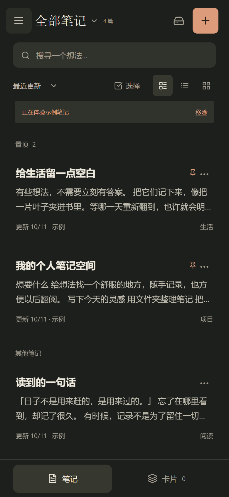
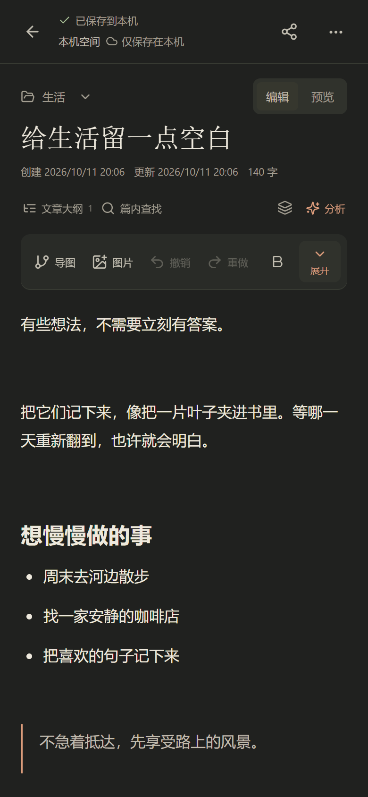
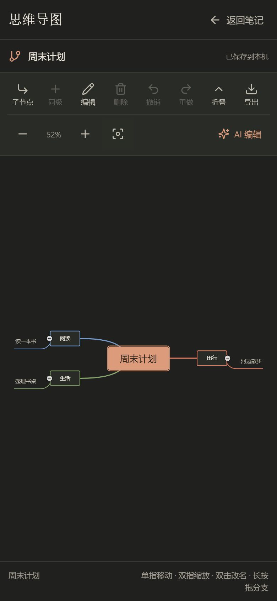

# 纸间 · 给想法一个地方

一个本地优先的个人笔记 App。随手记录文字与图片，用文件夹、卡片和思维导图慢慢整理自己的想法。

**[下载最新 Android APK](https://github.com/junnhwan/wanjune-notes/releases/latest)** · **[打开网页版](https://junnhwan.github.io/wanjune-notes/)** · Android 7.0 及以上

## 主要功能

- 富文本与辅助 Markdown 编辑，文字样式、高亮、图片、待办和自动保存。
- 多层文件夹、全文搜索、置顶、多种列表布局和回收站。
- 双面翻阅卡片；笔记内思维导图，支持节点编辑、移动、缩放和撤销。
- 知识空间与图谱；可选 AI 分析、导图生成和分支修改，结果先预览再应用。
- 可选账号与跨设备云同步；不登录也能本地记录，离线仍可编辑。
- 多组配色、暗色/浅色/跟随系统，以及完整 JSON 备份、HTML/TXT/PDF 导出和应用内更新。

## 界面预览

截图使用示例笔记与演示导图，来自当前版本的 Web 界面；Android 沿用同一套界面。

<table>
  <tr><th>笔记列表</th><th>富文本编辑</th><th>思维导图</th></tr>
  <tr>
    <td></td>
    <td></td>
    <td></td>
  </tr>
</table>

## 安装与更新

从 Releases 下载正式 `.apk`，按系统提示安装。应用设置支持检查更新、下载与校验，再交给系统确认安装；首次可能需要允许安装未知应用。

后续正式版直接覆盖安装，**不要先卸载**。升级前导出完整 JSON 备份；卸载或清除数据会删除本机笔记。包名固定为 `app.zhijian.notes`。

网页版与 Android 的本地数据各自独立。可以通过完整 JSON 备份迁移，或主动启用同一账号的云同步；恢复前另存当前备份，完整备份继续兼容历史格式。

## 本地使用与联网功能

本地笔记、图片、卡片和导图可离线使用，APK 不需要电脑在线。云同步和 AI 是可选联网功能；AI 需要可用的模型配置与账号权限，不是安装后自动对所有人开放。

请将完整 JSON 备份保存在应用外的位置；HTML/TXT/PDF 用于阅读与分享，不能替代完整备份。保存失败时保留草稿，先重试或导出，只有显示已保存才代表写入完成。

已开展浏览器与 Android 模拟器验证；厂商安装器、中文输入法及后台行为仍需真实手机反馈。此公开仓库分发 APK、编译后的网页、更新信息、介绍与截图，源码保存在私有仓库。
